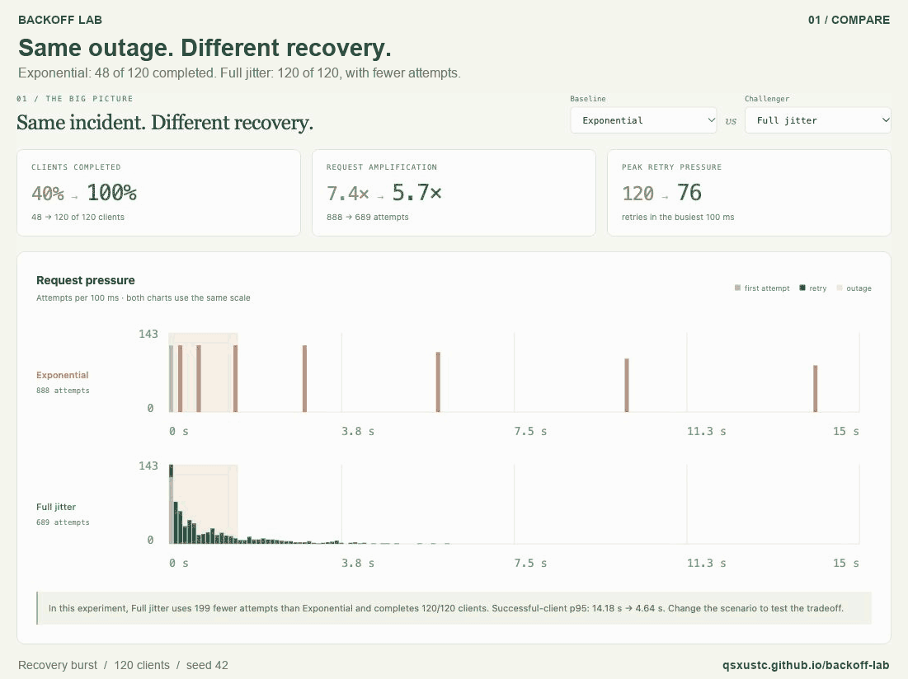

<p align="center">
  
</p>
<h1 align="center">Backoff Lab</h1>
<p align="center"><strong>See every retry.</strong><br>An interactive microscope for retry storms, backoff, and jitter.</p>
<p align="center">
  <a href="https://github.com/qsxustc/backoff-lab/actions/workflows/ci.yml"></a>
  <a href="LICENSE"></a>
  <a href="#try-it-locally"></a>
</p>
<p align="center">
  <strong><a href="https://qsxustc.github.io/backoff-lab/">Try the live demo →</a></strong>
  &nbsp;·&nbsp; <a href="https://github.com/qsxustc/backoff-lab/releases/tag/v1.0.0">Download v1.0.0</a>
  &nbsp;·&nbsp; <a href="README.zh-CN.md">简体中文</a>
  &nbsp;·&nbsp; <a href="docs/model.md">How the model works</a>
</p>

A service comes back online. Hundreds of clients retry together. **Why does recovery still fail?**

Backoff Lab lets you see the answer: compare five retry policies, watch requests cluster or spread, then click a client to follow every failure, wait, and success. Keep the seed and share the exact experiment with your team.

[](https://qsxustc.github.io/backoff-lab/)

<p align="center"><em>Real app recording. Click to run the experiment yourself.</em> · <a href="assets/demo.jpg">Static screenshot</a></p>

## One scenario, a visible difference

In the included **Recovery burst** scenario, 120 clients hit a service that is down for 1.5 seconds, then has 12 concurrent slots. All clients arrive together; seed **42** makes the experiment repeatable.

| Policy | Clients completed | Total attempts |
| --- | ---: | ---: |
| Exponential backoff | 48 / 120 | 888 |
| Full jitter | 120 / 120 | 689 |

Those are results for [this scenario](examples/recovery.json), not a universal ranking. Change the capacity, deadline, or seed and explore the tradeoffs. Attempts include each client's first request; **p95 counts successful clients only**.

## Why keep this in your toolbox?

- **Explain the thundering herd visually.** Compare request pressure on the same scale and replay the recovery.
- **Inspect the individual experience.** Select any client to see when it retried, why it failed, and how long it actually waited.
- **Make a design discussion reproducible.** Share a seeded scenario URL, export the raw attempts, or attach a standalone report.
- **Use it anywhere.** The browser and Node.js CLI share one deterministic engine. No API keys, account, or package installation required.

## Try it locally

Open the **[online demo](https://qsxustc.github.io/backoff-lab/)** to try the app without installing anything. To run it locally, use **Node.js 20 or newer** and a modern browser:

```sh
git clone https://github.com/qsxustc/backoff-lab.git
cd backoff-lab
npm run dev
```

Open **[http://127.0.0.1:4173](http://127.0.0.1:4173)**. There are no package dependencies to install, API keys to configure, or accounts to create. The simulation sends no network requests. The app needs a local HTTP server; opening `index.html` directly is not supported.

If the port is already occupied:

```sh
npm run dev -- --port 4174
```

## A one-minute experiment

1. Start with **Recovery burst**: 120 clients, a 1.5-second outage, and 12 concurrent server slots.
2. Compare **Exponential** with **Full jitter**. Watch when attempts cluster and when clients finish.
3. Pick a client row in the timeline to inspect the actual attempts and waits.
4. Try **Retry-After**, or spread the initial arrivals. Read completion count alongside latency.
5. Copy the experiment link or export the scenario to reproduce it later.

A shared link contains the scenario in its URL fragment. Use **Copy experiment link** in the [online demo](https://qsxustc.github.io/backoff-lab/) to share a link others can open directly. A link copied from `127.0.0.1` works only on a machine running the local server; export a JSON scenario to move experiments between the local app and online demo.

Links preserve the scenario parameters and seed. Policy selections, the selected client, and replay position are local view settings and are not included.

## What you can explore

- **Five policies:** fixed delay, exponential backoff, full jitter, equal jitter, and decorrelated jitter.
- **The whole burst:** compare request pressure on the same scale, completion counts, amplification, successful-client p95, and peak retry buckets.
- **One client's story:** replay the timeline, select a row, and inspect its attempt history.
- **Controlled experiments:** tune outage length, capacity, delays, attempt budget, deadline, initial spread, and the random seed.
- **Server hints:** apply a minimum Retry-After wait to each policy and observe the resulting timing.
- **Portable results:** import/export scenario JSON, copy a scenario URL, export attempts as CSV, or download a standalone HTML report.
- **A scriptable engine:** run the same scenario from the CLI or import the simulation as an ES module.

Everything runs locally. The app includes no analytics, external fonts, or third-party runtime dependencies.

<details>
<summary>See the client inspector</summary>


</details>

## Use the CLI

Compare all five policies:

```sh
node bin/backoff-lab.js
```

Compare selected policies against a scenario file:

```sh
node bin/backoff-lab.js --scenario examples/recovery.json --policy exponential --policy full
```

Export metrics as JSON, or include every attempt, client, and time bucket:

```sh
node bin/backoff-lab.js --scenario examples/recovery.json --format json --output results.json
node bin/backoff-lab.js --policy full --format json --events --output full-trace.json
node bin/backoff-lab.js --help
```

The CLI accepts UTF-8 JSON files up to 64 KiB. A scenario can be a partial object; missing fields take their defaults. Unknown fields and invalid values are rejected. Output files are overwritten when they already exist. The CLI supports table and JSON output; CSV and HTML report downloads are available in the browser.

### Use the engine directly

```js
import { compare, simulate } from './src/simulator.js';

const experiment = { clients: 120, outageMs: 1500, seed: 42 };
const results = compare(experiment);
const fullJitter = simulate(experiment, 'full');

console.log(results.map(({ policyId, metrics }) => ({ policyId, ...metrics })));
console.log(fullJitter.clients[0].events);
```

## Read the results carefully

Backoff Lab models a **finite burst against a server with concurrent request slots**. Capacity is not requests per second. Service time and failure response time are fixed; there is no server queue, continuous arrival stream, or real network traffic. A failed request does not occupy a server slot. An accepted request continues occupying its slot after its client times out, until its simulated service completes.

**p95 includes successful clients only.** A policy that gives up on many clients can display a small p95. Read completion count, attempt count, and deadlines together; a single seeded run does not establish a universally best policy.

The [model documentation](docs/model.md) defines every parameter, formula, metric, and event-ordering rule. This is an educational model for exploring tradeoffs, not a forecast of a production service.

## Build and develop

```sh
npm test
npm run build
npm run preview
```

`build` creates a static site in `dist/`. It can be served under a subdirectory by a static host, including GitHub Pages. `preview` serves that build at `http://127.0.0.1:4173`; stop the development server first or pass a different `--port`.

Pushes to `main` run the [GitHub Pages deployment workflow](https://github.com/qsxustc/backoff-lab/actions/workflows/pages.yml), which tests and builds the app before updating the online demo. The workflow can also be run manually.

| Path | Purpose |
| --- | --- |
| `src/simulator.js` | Validated scenarios, seeded randomness, discrete-event simulation |
| `src/app.js` | Browser controls, charts, inspection, and exports |
| `src/portable.js` | Scenario encoding, attempt CSV, and standalone HTML reports |
| `bin/backoff-lab.js` | CLI with table and JSON output |
| `tests/` | Simulation and CLI checks |
| `examples/recovery.json` | A reproducible starting scenario |
| `docs/model.md` | The simulation contract and its boundaries |

See [CONTRIBUTING.md](CONTRIBUTING.md) for development guidance, [CHANGELOG.md](CHANGELOG.md) for version history, and [docs/launch.md](docs/launch.md) for the release checklist and announcement drafts. Have a retry pattern that is hard to explain? [Open an issue](https://github.com/qsxustc/backoff-lab/issues) with a scenario or a question.

## Background and related work

The jitter terminology and policy formulas are informed by Marc Brooker's [Exponential Backoff and Jitter](https://aws.amazon.com/blogs/architecture/exponential-backoff-and-jitter/). That article studies an optimistic concurrency control model; Backoff Lab uses the concurrent-slot model documented here, so its numbers are not a reproduction of the article's results.

Related projects worth exploring:

- [AWS backoff simulator](https://github.com/aws-samples/aws-arch-backoff-simulator) — the simulator accompanying the AWS architecture article.
- [Retry Storm Lab](https://github.com/telemetry-sh/retry-storm-lab) — retry policy and traffic-amplification experiments.
- [ExplainLab](https://github.com/zhzhg-dev/explainlab) — interactive experiments with retry storms, cache stampedes, and queue overload.

Backoff Lab focuses on an inspectable per-client timeline, portable seeded scenarios, and one dependency-free engine shared by the browser and CLI.

## License

[MIT](LICENSE).
