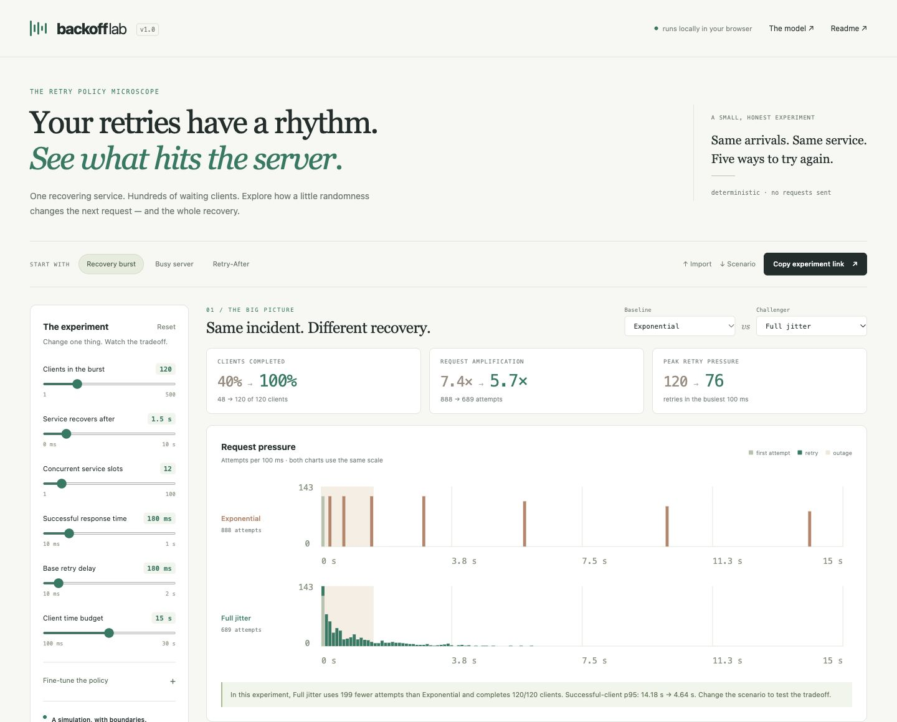
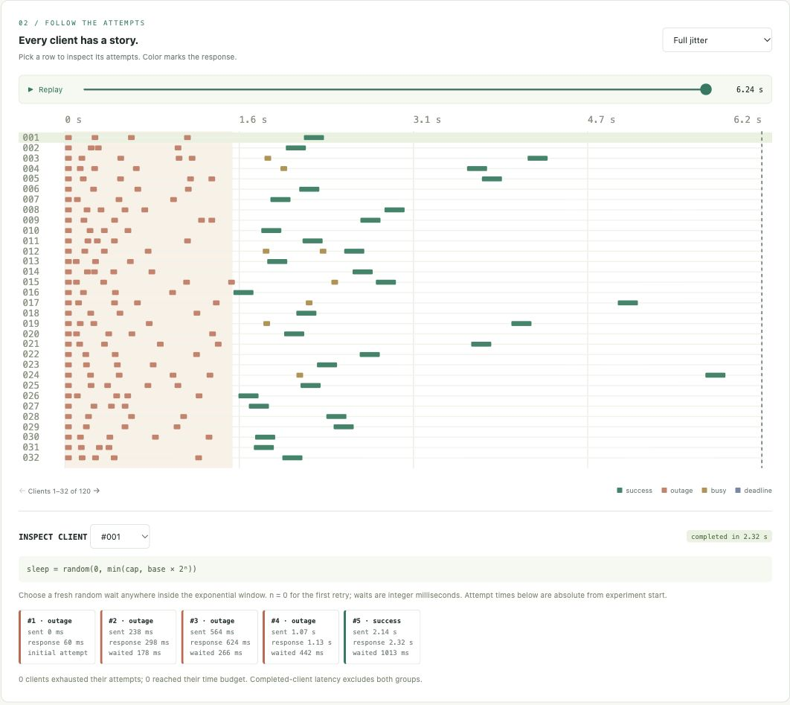

# Backoff Lab

**看见每一次重试，理解惊群效应。**

[在线 Demo](https://qsxustc.github.io/backoff-lab/) · [GitHub 仓库](https://github.com/qsxustc/backoff-lab) · [CI 状态](https://github.com/qsxustc/backoff-lab/actions/workflows/ci.yml) · [English](README.md) · [模拟模型](docs/model.md) · [贡献指南](CONTRIBUTING.md)

Backoff Lab 是一个交互式的重试策略显微镜：让几百个客户端同时面对一个正在恢复的服务，对比五种重试策略，再选中一个客户端，追踪它从首次失败到最终结果的完整过程。

浏览器应用、命令行工具和导出结果共用同一个确定性模拟引擎。修改参数、保留随机种子，就能把同一个实验交给团队复现。



<p align="center"></p>

## 本地运行

直接打开 **[在线 Demo](https://qsxustc.github.io/backoff-lab/)** 即可体验，无需安装。如需本地运行，准备 **Node.js 20 或更新版本**以及现代浏览器：

```sh
git clone https://github.com/qsxustc/backoff-lab.git
cd backoff-lab
npm run dev
```

打开 **[http://127.0.0.1:4173](http://127.0.0.1:4173)**。无需安装依赖、配置 API Key 或注册账户。模拟本身不会发出网络请求。请通过本地 HTTP 服务打开应用，不支持直接双击 `index.html`。

如果端口被占用：

```sh
npm run dev -- --port 4174
```

## 一分钟实验

1. 选择 **Recovery burst**：120 个客户端、1.5 秒故障、12 个服务器并发槽位。
2. 对比 **Exponential** 与 **Full jitter**，观察请求何时扎堆、客户端何时完成。
3. 在时间线中选中一行，查看该客户端每次请求与等待的细节。
4. 尝试 **Retry-After**，或将首次请求分散到一段时间内。结合完成数量一起看延迟。
5. 复制实验链接，或导出场景 JSON，稍后复现。

分享链接将场景保存在 URL 的 fragment 中。在[在线 Demo](https://qsxustc.github.io/backoff-lab/)中点击 **Copy experiment link**，即可生成别人能直接打开的实验链接。从 `127.0.0.1` 复制的链接需要接收者也运行本地服务；本地应用与在线 Demo 之间可以通过导出、导入 JSON 场景文件交换实验。

链接保存场景参数与随机种子。对比策略、当前选中的客户端和回放位置属于本地视图设置，不包含在分享链接中。

## 已有功能

- **五种策略**：固定延迟、指数退避、Full Jitter、Equal Jitter、Decorrelated Jitter。
- **整体对比**：相同刻度下的请求压力、完成数量、请求放大倍数、成功客户端 p95、重试峰值。
- **单个客户端追踪**：回放时间线，选择客户端，查看逐次请求记录。
- **可控参数**：故障时长、并发槽位、响应延迟、重试间隔、尝试次数、截止时间、初始请求分散范围和随机种子。
- **服务端提示**：对每种策略应用 Retry-After 最低等待时长，观察请求节奏的变化。
- **实验与结果导出**：JSON 场景导入导出、URL 分享、逐次请求 CSV、独立 HTML 报告。
- **可脚本化引擎**：通过命令行运行，或直接以 ES Module 导入。

所有计算均在本地完成。应用不含埋点、外部字体或第三方运行时依赖。界面为英文，仓库提供中英文说明。

## 命令行使用

对比所有策略：

```sh
node bin/backoff-lab.js
```

读取场景并对比指定策略：

```sh
node bin/backoff-lab.js --scenario examples/recovery.json --policy exponential --policy full
```

导出指标 JSON，或额外包含所有请求、客户端和时间桶数据：

```sh
node bin/backoff-lab.js --scenario examples/recovery.json --format json --output results.json
node bin/backoff-lab.js --policy full --format json --events --output full-trace.json
node bin/backoff-lab.js --help
```

CLI 接受最大 64 KiB 的 UTF-8 JSON 文件。场景可以只填写部分字段，其余字段使用默认值；未知字段和非法值会被拒绝。指定的输出文件若已存在会被覆盖。CLI 支持表格和 JSON 输出，CSV 与 HTML 报告通过浏览器下载。

### 直接调用模拟引擎

```js
import { compare, simulate } from './src/simulator.js';

const experiment = { clients: 120, outageMs: 1500, seed: 42 };
const results = compare(experiment);
const fullJitter = simulate(experiment, 'full');

console.log(results.map(({ policyId, metrics }) => ({ policyId, ...metrics })));
console.log(fullJitter.clients[0].events);
```

## 如何解读结果

这里模拟的是**有限的一批请求与具有固定并发槽位的服务器**。Capacity 表示同时处理的请求数量，不是每秒请求数。服务时间与失败响应时间固定，没有服务器排队、持续流入的新请求或真实网络流量。失败请求不占用服务器槽位；已被接受的请求即使客户端超时，也会继续占用槽位直到模拟服务完成。

**p95 只统计成功的客户端。** 如果一个策略放弃了许多客户端，它仍可能显示较低的 p95。请结合完成数、尝试次数和超时数量阅读结果。一个种子的实验结果不能证明某种策略永远最好。

[模型说明](docs/model.md)列出了每个参数、公式、指标和事件排序规则。该工具适合教学、设计讨论与理解取舍，不能直接预测线上服务表现。

## 开发与构建

```sh
npm test
npm run build
npm run preview
```

`build` 在 `dist/` 生成静态站点，可部署到支持子路径的静态托管服务，例如 GitHub Pages。`preview` 默认在 `http://127.0.0.1:4173` 预览构建产物；请先停止开发服务，或传入其他 `--port`。

推送到 `main` 分支会触发 [GitHub Pages 部署工作流](https://github.com/qsxustc/backoff-lab/actions/workflows/pages.yml)，通过测试和构建后自动更新在线 Demo，也可以在 Actions 中手动运行该工作流。

| 路径 | 用途 |
| --- | --- |
| `src/simulator.js` | 场景校验、带种子的随机数、离散事件模拟 |
| `src/app.js` | 浏览器控件、图表、逐客户端检查和导出 |
| `src/portable.js` | 场景编码、逐次请求 CSV 与独立 HTML 报告 |
| `bin/backoff-lab.js` | 表格与 JSON 命令行输出 |
| `tests/` | 模拟引擎与 CLI 检查 |
| `examples/recovery.json` | 可复现的初始场景 |
| `docs/model.md` | 模型契约与适用边界 |

开发规范见 [CONTRIBUTING.md](CONTRIBUTING.md)，发布步骤和宣传草稿见 [docs/launch.md](docs/launch.md)。

## 背景与相关项目

Jitter 的术语和策略公式参考 Marc Brooker 的 [Exponential Backoff and Jitter](https://aws.amazon.com/blogs/architecture/exponential-backoff-and-jitter/)。该文章研究乐观并发控制；Backoff Lab 使用本文档定义的并发槽位模型，因此本项目的数值并非该文章实验结果的复现。

推荐了解这些相关项目：

- [AWS backoff simulator](https://github.com/aws-samples/aws-arch-backoff-simulator)：AWS 架构文章的配套模拟器。
- [Retry Storm Lab](https://github.com/telemetry-sh/retry-storm-lab)：重试策略与流量放大实验。
- [ExplainLab](https://github.com/zhzhg-dev/explainlab)：重试风暴、缓存击穿和队列过载的交互实验。

Backoff Lab 的重点是可检查的逐客户端时间线、可交换的带种子场景，以及浏览器与 CLI 共用的零依赖引擎。

## 开源协议

[MIT](LICENSE)。
